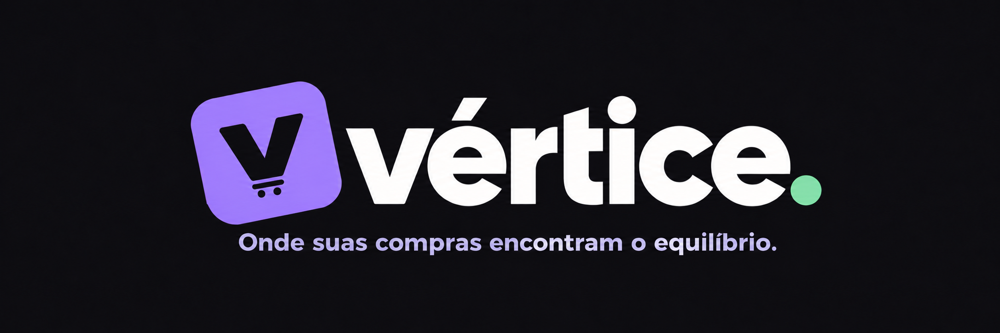
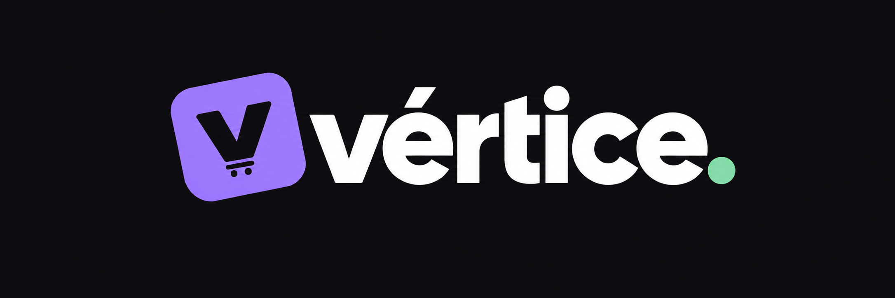
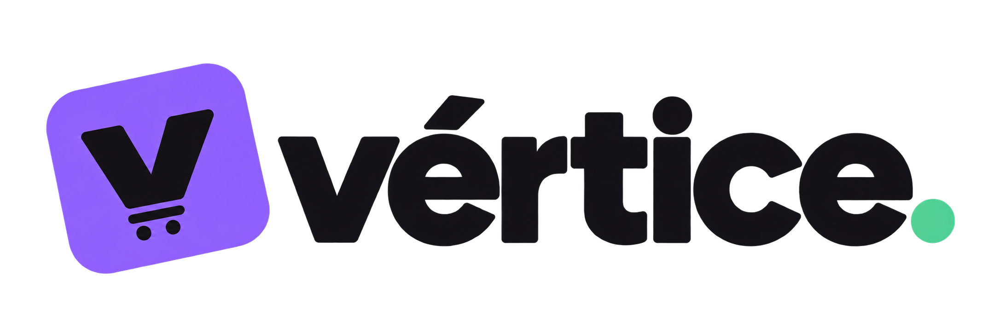

# Artes do Vértice

[**Baixar todas as artes em ZIP**](https://github.com/gaugerr/vertice-web/raw/refs/heads/main/artes/vertice/vertice-marca.zip)

Clique no nome de cada arquivo e em **Download raw file** para baixar o PNG original.

## Ícone para Google

[Baixar ícone](icone-google.png)

## Capa para Cakto

[Baixar capa](capa-cakto.png)

Ilustração conceitual do kit; não é captura real das interfaces.

## Logo com frase

## Logo para fundo escuro

Fundo escuro incorporado ao PNG.

## Logo para fundo claro

PNG transparente com letras escuras.

As peças são PNGs rasterizados. Confira limites de dimensão e peso antes do upload nas plataformas. Esta pasta é uma biblioteca de download; não substitui os recursos publicados do app ou site.
