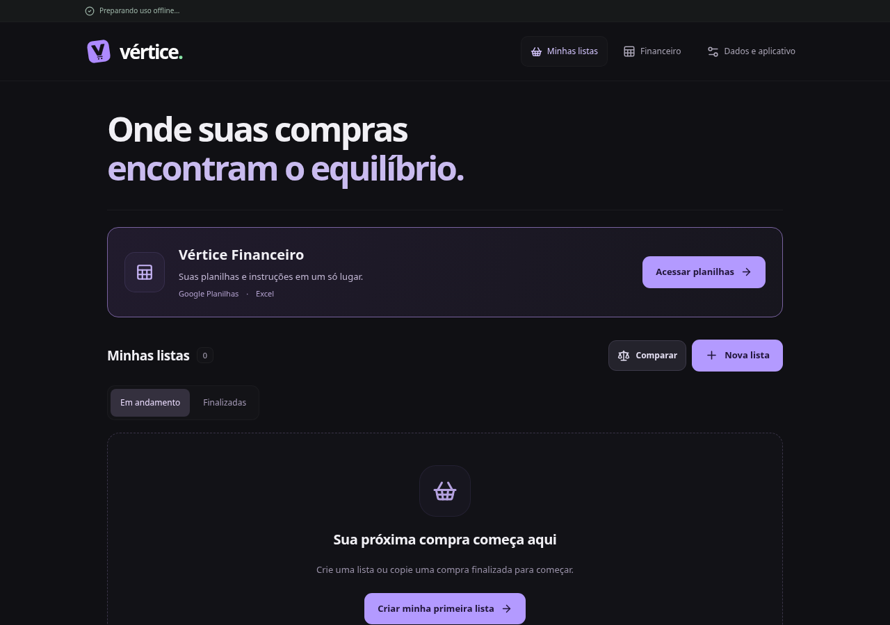
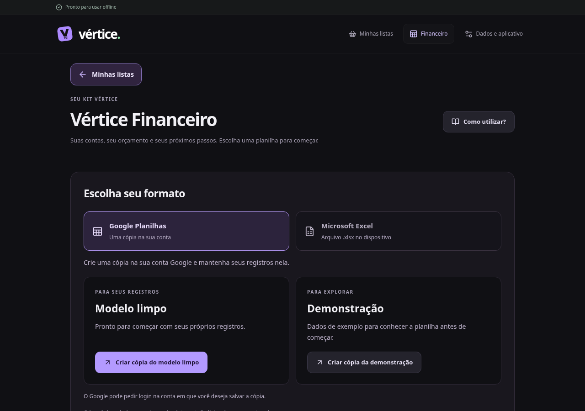
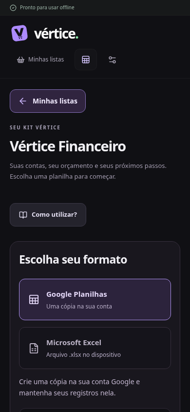

# Vértice Financeiro

Central protegida em `/financeiro`, dentro de `Root`/`AccessBoundary`. Não há novo
login, integração com dados financeiros, sincronização ou alteração no banco de
compras. O desenvolvimento local mantém o modo legacy existente; Cloudflare
continua exigindo licença pelo build protegido.

## Entrega e conteúdo

- Links de cópia Google e download Excel em `src/features/finance/config.ts`.
- Tutorial, mapa das abas, dicas e FAQ em `src/features/finance/guide.ts`.
- Modelos limpo e demonstração são independentes das cópias pessoais. Os botões
  não localizam nem atualizam o arquivo já salvo pelo comprador.
- Downloads/cópias abrem em outra aba e exigem internet. Não há confirmação de
  cópia ou download concluído. Google pode pedir uma sessão própria.
- No celular, o aplicativo Google Planilhas pode interceptar `/copy` e abrir o
  modelo. A tela orienta a fazer uma cópia pelo menu do Planilhas ou usar o
  navegador/computador. Cada modelo tem “Copiar link”, com seleção manual se a
  área de transferência for negada. Não há promessa de forçar o navegador.
  No Android, o botão principal usa um Android Intent direcionado ao pacote do
  Chrome com o mesmo `/copy` e fallback HTTPS. O intent é acionado diretamente
  pelo clique, na mesma aba; não usa timers ou redirecionamento automático.
  Outros sistemas mantêm HTTPS em nova aba. A escolha do app e a tela de cópia
  precisam de validação em aparelho real; emulação só verifica o destino gerado.
- Os links foram liberados pelo proprietário para qualquer pessoa com o link.
  A proteção da rota não torna os destinos privados nem impede compartilhamento.
  Não adicionar os arquivos pagos ao GitHub público.
- Guia baseado na estrutura consultada em 25/10/2026: Dashboard, Lançamentos,
  Contas Fixas, Reajustes, Orçamento, Resumo Anual, Metas e Config. Não promete
  atualização de categorias/histórico de pagamentos não validada nas cópias.

## Primeira visita

O cartão inicial reduz após montar `/financeiro`. Só se registra a visita, não a
criação de uma cópia. Preferência versionada em localStorage, chave por
`useAccountScope()` (projeto/uid; legacy no desenvolvimento local). Falhas de
armazenamento não bloqueiam o acesso. Preferências não sincronizam entre aparelhos
e ficam fora dos backups de compras.

## Validação e publicação

`visit.test.ts` cobre isolamento da preferência e armazenamento negado.
`e2e/finance.spec.ts` cobre navegação, quatro destinos, foco do tutorial,
preferência persistente, layouts e leitura offline em Chromium. Não utiliza
contas reais nem modifica as planilhas.

Ao substituir modelos, testar os quatro links em outra conta, e conferir em cópias
de trabalho os cálculos, recorrência/reajustes, mudança de mês e compatibilidade
Google/Excel. A validação do app não certifica fórmulas dos modelos externos.

A prévia Cloudflare deve usar uma branch fora de main e manter acesso protegido.
Autorizar origem exata e callback no serviço de acesso antes do login real; não
ampliar CORS com curingas nem desabilitar licença. Merge somente após revisão do
proprietário.

## Capturas para revisão

Capturas locais da interface com dados vazios de teste (sem conta pessoal).

### Entrada na página inicial

### Central no computador

### Central no celular

