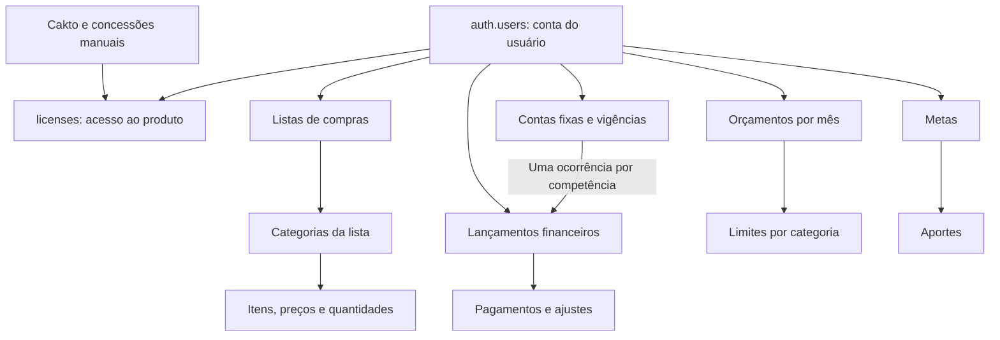

# Vértice — rascunho do banco por usuário

**Estado: proposta técnica testada isoladamente, ainda não aplicada.**
O SQL fica em `supabase/drafts/`, fora de `supabase/migrations/`, para não entrar
automaticamente em um deploy. O nome do arquivo foi gerado pelo Supabase CLI 3.0.0
com `migration new` em diretório local isolado. A integração de sincronização e os
endpoints de gravação ainda precisam ser implementados e testados antes de ativar.

## O que foi conferido no projeto atual

Inspeção somente de metadados em 09/11/2026, projeto `vertice`
(`wqutcsjdozcukwxvkbtc`, us-east-1, PostgreSQL 17.11):

- `auth.users` identifica a conta Google usada pelo app.
- A única tabela atual em `public` é `licenses`, com RLS e leitura apenas da própria licença.
- `licenses.user_id` referencia a conta; status, origem de provisionamento e decisões manuais controlam acesso.
- `access_private` contém administradores, auditoria, eventos, produtos, pedidos e mudanças de licença da Cakto.
- Compras são locais em IndexedDB; o financeiro da preview usa localStorage.
- Nenhuma tabela, licença, webhook, função, chave ou agendamento de produção foi alterado.

**A propriedade dos dados usa `auth.users.id`, nunca e-mail nem ID da licença.**
Assim, trocar uma licença, revogar acesso ou mudar o e-mail não transfere os dados
financeiros para outra pessoa. A Cakto continua tratando o acesso comercial; os
gastos pessoais não são pedidos da Cakto.

## Visão simples



Essa organização não adiciona telas nem exige novos preenchimentos no aplicativo.
Ela separa os registros para permitir cálculos, relatórios e isolamento por usuário.

## Tabelas propostas

| Grupo        | Tabelas                                                                     | Finalidade                                                                       |
| ------------ | --------------------------------------------------------------------------- | -------------------------------------------------------------------------------- |
| Compras      | `shopping_lists`, `shopping_categories`, `shopping_items`                   | Preservar listas, conclusão, orçamento, categorias, produtos, marca e embalagem  |
| Cadastros    | `finance_categories`, `finance_payment_methods`                             | Categorias de receita/despesa e formas de pagamento próprias de cada pessoa      |
| Recorrência  | `finance_fixed_accounts`, `finance_fixed_versions`                          | Início/fim e valores com vigência mensal                                         |
| Movimentação | `finance_entries`, `finance_payments`                                       | Avulsos e ocorrências fixas na mesma base, pagamentos parciais e ajustes         |
| Planejamento | `finance_budget_months`, `finance_budget_limits`, `finance_budget_defaults` | Meses independentes; conservar a base antiga para meses ainda não personalizados |
| Objetivos    | `finance_goals`, `finance_goal_contributions`                               | Saldo inicial, objetivo e histórico corrigível de aportes                        |
| Importação   | `user_import_batches`                                                       | Identificar importações já concluídas, por usuário, origem e conteúdo            |

São 15 tabelas novas e duas views de leitura. Não há uma segunda tabela de usuários
nem uma cópia de e-mails ou credenciais nas tabelas de compras/finanças.

## Regras centrais

**Propriedade e segurança.** Todas as tabelas têm `user_id`, RLS, políticas de leitura,
inclusão e atualização, e permissões explícitas. `anon` não tem acesso. `UPDATE`
verifica dono antes e depois; triggers também impedem mudar identidade e dono.
As referências incluem o usuário: um item não pode usar uma categoria de outra
conta nem de outra lista. Um pagamento não pode apontar para uma despesa alheia.
As views usam `security_invoker=true`. Os helpers são triggers com
`security invoker` em schema não exposto; nenhum usa `SECURITY DEFINER`.

**Licença, proposta provisória.** Ler os próprios dados não depende de uma licença
ativa; incluir ou atualizar exige `licenses.status='active'` para a conta autenticada.
Revogação bloqueia novas gravações, sem apagar os registros. Isso permite no futuro
oferecer consulta/exportação de dados próprios. Essa política comercial deve ser
revisada ao preparar a ativação; a interface oficial de acesso não foi alterada.

**Valores.** Finanças usam centavos inteiros, com limites coerentes com a preview.
Preços e quantidades dos itens usam `numeric` exato, preservando frações atuais.
O total de cada item arredonda meio para cima para centavos, como `lineCents` no app.
Não há `float`, saldo bancário armazenado nem total de relatório gravado manualmente.
Os `bigint` devem ser tratados com conversão verificada pelo adaptador TypeScript.

**Competência e pagamentos.** A ocorrência mensal é uma `finance_entry`, distinta
do modelo da conta fixa. A combinação usuário + conta fixa + competência é única.
O pagamento tem data real separada da competência. O histórico admite pagamentos
positivos e ajustes assinados, mantendo a soma entre zero e o limite permitido.

`finance_entry_totals` calcula:

```text
pago = soma dos pagamentos/ajustes não desfeitos
previsto = maior entre (valor planejado − desconto explícito) e pago
pendente = maior entre (valor planejado − desconto explícito − pago) e zero
```

Uma conta de R$ 100 paga em R$ 60 continua com R$ 40 pendentes. O restante pode ser
liquidado por outro pagamento ou por desconto explícito. Receber/pagar em dezembro
uma competência de novembro continua nos indicadores de novembro. Campos de uma
ocorrência fixa com pagamentos são preservados contra reajustes implícitos.

**Orçamento.** Uma linha em `finance_budget_months` marca um mês configurado, inclusive
se ele não tiver limites. Sem essa marca, o adaptador usa `finance_budget_defaults`.
Um limite zero é diferente de ausência de limite. Copiar o mês anterior deve copiar
linhas em transação, nunca manter referências mutáveis compartilhadas.

**Metas.** `finance_goal_totals` soma o saldo inicial e os aportes não desfeitos.
Editar ou desfazer um aporte modifica o progresso, sem criar despesa implicitamente.
Uma constraint verifica o total para não ultrapassar o limite financeiro.

## Preservação dos dados locais

O modelo de compras já usa UUIDs; eles devem ser preservados. O financeiro atual
tem IDs como `R01`, `D01`, `reserve`, UUIDs e `conta:2026-11`. Por isso os IDs
financeiros são texto com chave composta `(user_id,id)`: duas pessoas podem ter
`D01` sem conflito. Novos registros continuam podendo usar UUIDs em texto.
Não é preciso inventar novos identificadores e refazer todos os vínculos na migração.

| Estado atual                          | Destino / cuidado                                                                                                 |
| ------------------------------------- | ----------------------------------------------------------------------------------------------------------------- |
| `lists`, `categories`, `items`        | Preservar UUIDs, datas originais em `client_*`, preços/quantidades exatos e relações                              |
| `categories`, `methods` do financeiro | Preservar IDs; `active=false` vira arquivamento, sem apagar referências                                           |
| `entries` avulsos                     | `finance_entries`, com receita/despesa e competência derivada da data; confirmações viram movimentos de pagamento |
| `fixedAccounts.versions`              | Conta e vigências; gerar uma única ocorrência por mês conforme a versão, ajustando 29–31 ao último dia válido     |
| `occurrences`                         | Materializar ajustes pontuais e snapshots pagos/parciais; não gerar uma segunda despesa                           |
| Histórico assinado de pagamento       | Movimentos com IDs determinísticos por ocorrência e posição; preservar soma, datas e observações                  |
| Quitações antigas abaixo do previsto  | Preservar a quitação anterior com desconto explícito; não transformar retroativamente em dívida                   |
| `budgets` antigos                     | `finance_budget_defaults`, ignorando valores nulos que significam sem limite                                      |
| `monthlyBudgets`                      | Uma marca de mês mesmo quando vazia, com seus limites independentes                                               |
| `goals`                               | Saldo inicial + histórico quando existente; sem histórico, o total atual vira saldo inicial, sem inventar datas   |
| Backup JSON                           | Validar a versão, referências e totais antes da transação de importação                                           |

O importador precisa da confirmação de qual conta receberá os dados locais. Deve
validar o usuário autenticado no servidor, fazer a importação e registrar o lote
na mesma transação, comparar os totais antes/depois e preservar o backup local.
Um lote repetido não pode criar duplicatas. Se o mesmo ID já existir com conteúdo
diferente, retornar conflito para revisão; não sobrescrever silenciosamente.
Dados fictícios da preview não devem ser enviados automaticamente para contas reais.

## Preparação para sincronização

- `created_at`/`updated_at` são carimbados no servidor; datas originais ficam em `client_*`.
- `row_version` aumenta no servidor e não pode ser escolhido pelo cliente.
- Atualizações deverão exigir a versão anterior; zero linhas alteradas significa conflito.
- `deleted_at` mantém uma exclusão sincronizável. O cliente não tem permissão de `DELETE` físico.
- Retirar uma categoria/lista/meta exige tratar os filhos na mesma operação; o schema não finge implementar essa transação.
- Relações com `auth.users` são restritivas: exclusão completa de conta deve ser uma operação administrativa coordenada, com revogação de sessões e descarte controlado dos dados.

**Ainda não é um protocolo de sincronização.** Antes de conectar o frontend, criar
RPCs/transações com IDs de operação, controle de versão, bloqueio adequado do registro
e geração idempotente das ocorrências fixas. Para download incremental, definir
cursor com ordenação de commit por usuário ou estratégia equivalente validada;
`updated_at` e uma sequência global, sozinhos, não garantem ausência de perda de mudanças.
Preservar fila offline local e nunca remover uma operação antes da confirmação.

## Validação executada e limites

48 verificações passaram em PostgreSQL embarcado (PGlite 0.5.15, PostgreSQL 18.6),
com Auth/licenças sintéticos e sem conexão com produção. Cobertura:

- duas contas isoladas, inclusive views e tentativas de trocar proprietário;
- referências cruzadas entre contas/listas rejeitadas;
- bloqueio de leitura anônima, exclusão física e gravação sem licença ativa;
- pagamentos de R$ 60 + R$ 40, correção, desconto, competência e tentativa de duplicação;
- metas/aportes, limites zero e mensais, lote repetido e versões do servidor;
- objetos sintéticos de licença/Cakto inalterados pelo SQL.

Reprodução isolada:

```sh
npm ci --prefix supabase/drafts/user-data/validation
npm test --prefix supabase/drafts/user-data/validation
```

O projeto real usa PostgreSQL **17.11**. Antes de aplicar: validar o mesmo SQL num
ambiente de homologação PostgreSQL 17/Supabase, executar advisors, testar JWTs reais,
Data API, fluxos de licença e concorrência entre aparelhos. Os testes atuais não
substituem essas verificações, não testam o webhook real e não comprovam sincronização.

## Próxima etapa de implementação

1. Revisar este desenho com os fluxos que forem aprovados na preview.
2. Implementar e testar as transações/RPCs e o mapeamento de importação.
3. Homologar segurança com duas contas e licença revogada em Supabase isolado.
4. Conectar primeiro um pequeno fluxo de compras, preservando operação offline.
5. Conectar financeiro usando os mesmos IDs, competência e regras de cálculo.
6. Só então preparar uma migração ativa e uma ativação gradual de produção.

Referências consultadas: [RLS](https://supabase.com/docs/guides/database/postgres/row-level-security),
[CLI v3](https://supabase.com/changelog/supabase-cli-v3), [changelog](https://supabase.com/changelog).
